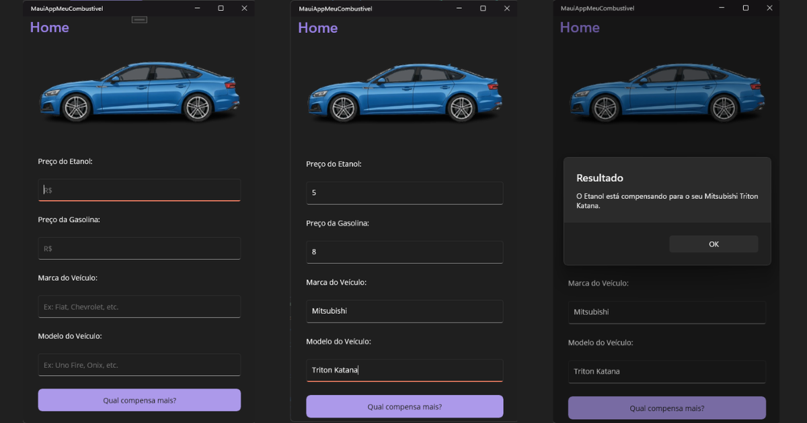

# 🚗 Meu Combustível (.NET MAUI)

Aplicativo mobile desenvolvido em **.NET MAUI** para cálculo da relação de preço entre Etanol e Gasolina, indicando qual combustível é mais vantajoso financeiramente para o veículo do usuário.

Projeto desenvolvido para a agenda do curso técnico da **ETEC**.

---

## 📸 Demonstração do Aplicativo



---

## 🛠️ Funcionalidades

- Entrada dos preços de **Etanol** e **Gasolina**.
- Cadastro dos dados do veículo: **Marca** e **Modelo**.
- Cálculo dinâmico baseado no fator de eficiência de 70% ($Etanol / Gasolina$).
- Exibição de alerta customizado com a recomendação de combustível direcionada ao veículo informado.

---

## 💻 Tecnologias Utilizadas

- **C#**
- **.NET MAUI**
- **XAML** (Interface de Usuário)

---

## ⚙️ Regra de Negócio

O aplicativo calcula a razão entre os preços dos combustíveis:

$$\text{Razão} = \frac{\text{Preço do Etanol}}{\text{Preço da Gasolina}}$$

- Se a razão for **maior ou igual a 0,7 (70%)**, a recomendação será **Gasolina**.
- Caso contrário, a recomendação será **Etanol**.

---

## 🚀 Como Executar o Projeto

1. Certifique-se de ter o **Visual Studio 2022** (com suporte ao desenvolvimento .NET MAUI) instalado.
2. Clone este repositório:
   ```bash
   git clone https://github.com/hugoarcanjodev/etec-mauiapp-meucombustivel.git
   ```
3. Abra a solução `MauiAppMeuCombustivel.sln` no Visual Studio.
4. Escolha o dispositivo ou emulador (Android, iOS ou Windows).
5. Compile e execute a aplicação (`F5`).

---

## 🎓 Autor

Desenvolvido como parte do currículo prático do curso técnico da **ETEC**.